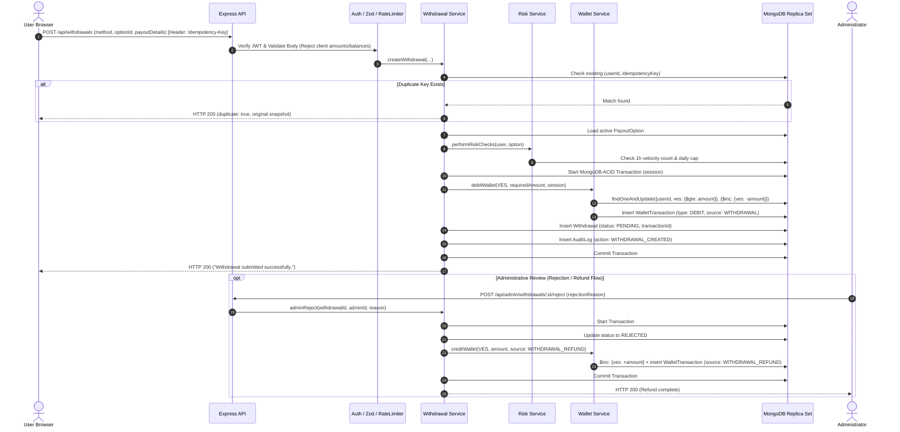
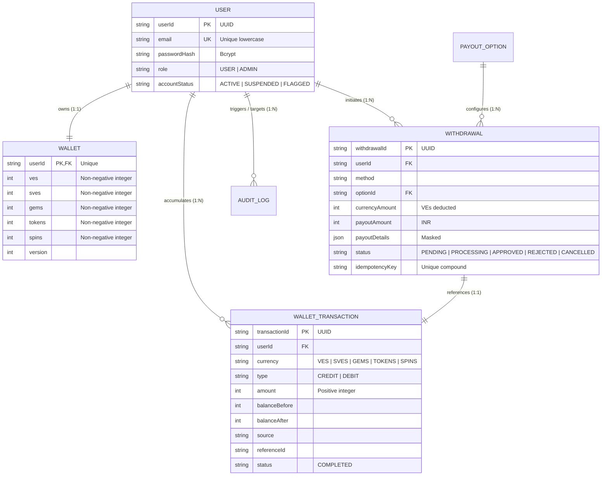

# VELoop Rewards Wallet & Payout System

A robust, enterprise-grade, backend-driven rewards wallet and payout system built for VELoop Rewards. Features an immutable double-entry ledger, multi-document atomic MongoDB ACID transactions, idempotent payout pipelines, strict anti-tampering defenses, fraud/velocity risk controls, and a React 18 interface.

---

## Table of Contents
1. [Core Architectural Paradigm & Most Important Rule](#1-core-architectural-paradigm--most-important-rule)
2. [Financial State Strategy (Option A vs. Option B)](#2-financial-state-strategy-option-a-vs-option-b)
3. [Technology Stack](#3-technology-stack)
4. [Monorepo Project Layout](#4-monorepo-project-layout)
5. [Local Development & Quick Start](#5-local-development--quick-start)
6. [Automated Testing & Coverage](#6-automated-testing--coverage)
7. [Architecture & System Flow](#7-architecture--system-flow)
8. [Database Architecture & Data Model](#8-database-architecture--data-model)
9. [Security, Integrity & Tamper Resistance](#9-security-integrity--tamper-resistance)
10. [Evaluator Guide: Step-by-Step Testing & Verification](#10-evaluator-guide-step-by-step-testing--verification)
11. [1-Page Demo Video Script](#11-1-page-demo-video-script)
12. [Final Challenge: Scaling from 1,000 to 1,000,000 Users](#12-final-challenge-scaling-from-1000-to-1000000-users)
13. [Submission Checklist & Documentation Links](#13-submission-checklist--documentation-links)

---

## 1. Core Architectural Paradigm & Most Important Rule

> **THE BACKEND OWNS 100% OF THE FINANCIAL LOGIC.**  
> The client is strictly a presentation interface. The frontend is permitted to send ONLY abstract identifiers (`method="upi"`, `optionId="upi_10"`, destination recipient details, and a UUID `Idempotency-Key` header). It must **NEVER** send amounts, currencies, balances, or required VEs.

- **Tamper Proof**: If any client attempts to send `amount`, `requiredAmount`, `currency`, or `balance` in the payload, the backend rejects it immediately with **HTTP 400 Bad Request**.
- **Server Lookup**: The backend queries the database for the active payout option, verifies account status, age, and velocity limits, and executes an atomic conditional deduction.
- **Integer Math Only**: All currency units (VEs, SVEs, Gems, Tokens, Spins) are strictly whole non-negative integers (`Number.isInteger`, min: 0). Floating-point arithmetic is prohibited across the platform.

---

## 2. Financial State Strategy (Option A vs. Option B)

### Why Option A Was Chosen (Immediate Deduct + Compensating Refund)
In this implementation, we adopted **Option A**:
1. When a withdrawal request is submitted, VEs are **deducted immediately** from the user's wallet within a single atomic MongoDB transaction (`session`), and a corresponding debit transaction (`source: WITHDRAWAL`) is written to the immutable ledger.
2. If an administrator later **REJECTS** the withdrawal, or the user **CANCELS** it while still `PENDING`, a **compensating CREDIT entry** (`source: WITHDRAWAL_REFUND`) is generated within an atomic session that restores the VEs to the wallet and sets the withdrawal status to `REJECTED` or `CANCELLED`.
3. An engine-level partial unique index on `{ referenceId: 1, source: 1 }` guarantees that a withdrawal can **never be refunded twice**.

**Engineering Rationale for Option A**:
- **Zero Overdraft Exposure**: Prevents users from initiating a withdrawal and subsequently spending those same VEs on in-app activities while the withdrawal is under administrative review.
- **Simplified Balance Invariants**: The balance field `ves` represents spendable liquidity at all times (`ves >= 0`). There is no need for fragile multi-field balance reconciliations.
- **Auditability via Double-Entry Ledger**: Reversals are recorded as explicit compensating credits with their own timestamps and before/after snapshots, ensuring full transparency.

### Comparison with Option B (Reserved Balance Bucket)
In Option B, creating a withdrawal decrements `availableVes` and increments `reservedVes`. On approval, `reservedVes` is decremented; on rejection, it is returned to `availableVes`. While Option B preserves total equity in a dedicated field, it introduces significant schema complexity across every transaction, increases lock contention, and complicates balance reconciliation.

---

## 3. Technology Stack

- **Backend**: Node.js 20+, Express, MongoDB with Mongoose, JWT auth, Bcrypt, Zod validation, Helmet, CORS, Express-Rate-Limit, Pino logging, Dotenv.
- **Database**: MongoDB 7.0 WiredTiger (Single-node Replica Set `rs0` for local dev/Docker; MongoDB Atlas 3-node replica set for cloud deployment).
- **Frontend**: React 18, Vite, React Router v6, Axios, Bootstrap 5.
- **Testing**: Jest v29, Supertest v7, `mongodb-memory-server` v10 (Replica Set mode with multi-document transactions).
- **DevOps**: Docker, Docker Compose, Nginx, Render config (`render.yaml`), Vercel SPA rewrite (`vercel.json`), GitHub Actions CI.

---

## 4. Monorepo Project Layout

```
├── backend/
│   ├── src/
│   │   ├── app.js                 # Express application & middleware assembly
│   │   ├── server.js              # HTTP server & graceful shutdown handler
│   │   ├── config/                # Constants, DB connection
│   │   ├── controllers/           # Auth, Wallet, Payout, Withdrawal, Admin controllers
│   │   ├── middleware/            # Auth, Zod validator, Rate limiter, Error & Sanitize
│   │   ├── models/                # User, Wallet, WalletTransaction, PayoutOption, etc.
│   │   ├── routes/                # Auth, Wallet, Payout, Withdrawal, Admin routes
│   │   ├── services/              # WalletService, WithdrawalService, PayoutService, RiskService
│   │   └── utils/                 # Errors, Logger, TransactionHelper, Reconcile engine
│   ├── seed/                      # payoutOptions.js, demoData.js
│   ├── tests/                     # Jest & Supertest suites (13 required scenarios)
│   ├── Dockerfile
│   └── package.json
├── frontend/                      # React 18 + Vite SPA
│   ├── src/                       # App, Context, Pages (Login, Wallet, Payout), DevToolsBox
│   ├── Dockerfile
│   └── package.json
├── docs/                          # Architecture, Database, Test Results, Checklist
│   ├── ARCHITECTURE.md
│   ├── DATABASE.md
│   ├── TEST_RESULTS.md
│   ├── CHECKLIST.md
│   ├── DEPLOYMENT.md
│   ├── VELoop-Wallet.postman_collection.json
│   └── VELoop-Wallet.postman_environment.json
├── docker-compose.yml             # Full stack orchestration with Mongo replica set
├── API_DOCUMENTATION.md           # Exhaustive endpoint documentation
├── ASSUMPTIONS.md                 # Engineering decisions & payout calibration notes
└── README.md
```

---

## 5. Local Development & Quick Start

### Option 1: Full Stack via Docker Compose (Recommended)
The fastest way to spin up the entire system including the MongoDB Replica Set:
```bash
# Clone the repository
git clone https://github.com/swati-patil-11/VeLoop_Wallet_withdrawal.git
cd VeLoop_Wallet_withdrawal

# Build and start all services (Mongo Replica Set + Backend + Frontend)
docker-compose up --build
```
- Frontend UI: `http://localhost:5173`
- Backend API: `http://localhost:5000`
- MongoDB Replica Set: `mongodb://localhost:27017/veloop_rewards?replicaSet=rs0`

### Option 2: Running Directly on Host Machine

#### Step 1: Install Dependencies
```bash
# Backend
cd backend && npm install

# Frontend
cd ../frontend && npm install
cd ..
```

#### Step 2: Configure Environment Variables
```bash
cp backend/.env.example backend/.env
```
Ensure your MongoDB instance is running as a replica set (`rs0`).

#### Step 3: Seed Database
```bash
cd backend
npm run seed
```
This idempotently provisions:
- Payout options (UPI calibrated tiers, placeholder options for PayPal, Amazon, Google Play).
- Demo Users: `demo@veloop.test` (25,000 VEs + ledger), `demo2@veloop.test`, `admin@veloop.test`.

#### Step 4: Start Services
```bash
# Terminal 1 - Backend (port 5000)
cd backend && npm run dev

# Terminal 2 - Frontend (port 5173)
cd frontend && npm run dev
```

---

## 6. Automated Testing & Coverage

The automated test suite runs on an isolated in-memory MongoDB Replica Set (`mongodb-memory-server` in WiredTiger replica set mode).

```bash
cd backend

# Run all 13 required test scenarios
npm test

# Run tests with code coverage report
npm run test:coverage

# Run ledger reconciliation engine across all user balances
npm run reconcile
```

All 13 required scenarios pass with 100% success rate:
- ✅ **Scenario 1**: Normal credit updates balance and ledger (`balanceBefore`/`After`).
- ✅ **Scenario 2**: Normal withdrawal deducts correct VEs and links debit ledger.
- ✅ **Scenario 3**: Insufficient balance rejected; balances unchanged.
- ✅ **Scenario 4**: Double-click with same `Idempotency-Key` executes exactly once.
- ✅ **Scenario 5**: Concurrent race condition with different keys permits strictly one withdrawal; balance never negative.
- ✅ **Scenario 6**: Fake `optionId` and inactive methods are rejected.
- ✅ **Scenario 7**: Multi-tenant isolation: User A cannot read User B's wallet or withdrawals.
- ✅ **Scenario 8**: Admin rejection restores balance exactly once; no double refunds.
- ✅ **Scenario 9**: API manipulation (sending `amount`, `currency`) rejected with 400.
- ✅ **Scenario 10**: Unauthenticated returns 401; non-admin accessing admin routes returns 403.
- ✅ **Scenario 11**: Rate limiting triggers HTTP 429 on excessive requests.
- ✅ **Scenario 12**: Reconciliation engine asserts `wallet = sum(credits) - sum(debits)` with 0 drift.
- ✅ **Scenario 13**: Transaction rollback on simulated crash leaves wallet balance unchanged.

Full results matrix documented in [`docs/TEST_RESULTS.md`](./docs/TEST_RESULTS.md).

---

## 7. Architecture & System Flow



See [`docs/ARCHITECTURE.md`](./docs/ARCHITECTURE.md) for detailed sequence diagrams and failure handling logic.

---

## 8. Database Architecture & Data Model



Detailed model descriptions and index rationales are cataloged in [`docs/DATABASE.md`](./docs/DATABASE.md).

---

## 9. Security, Integrity & Tamper Resistance

1. **Authentication & Multi-Tenant Isolation**:
   - Passwords salted and hashed with bcrypt (10 rounds).
   - JWT tokens signed with HMAC-SHA256 (`JWT_SECRET`).
   - The user ID is **always extracted from the verified token** (`req.user.userId`). Passing `?userId=` or body parameters is ignored, ensuring cross-tenant data exposure is impossible.
2. **Schema Enforcement & Mass Assignment Protection**:
   - Zod schemas use `.strict()`. Any unexpected client property causes an immediate rejection.
3. **Double-Click & Replay Protection**:
   - Every mutation accepts an `Idempotency-Key` header (UUID).
   - Compound unique index on `{ userId: 1, idempotencyKey: 1 }` prevents concurrent execution.
4. **NoSQL Injection Defense**:
   - Input sanitization strips keys containing `$` or `.`.
5. **Rate Limiting**:
   - Global rate limiter (500 requests / 15 min).
   - Auth limiter (20 requests / 15 min).
   - Withdrawal limiter (10 requests / 1 hour).
6. **Append-Only Audit Logs**:
   - Financial mutations and administrative reviews generate permanent `auditlogs` records with client IP and user-agent metadata.

---

## 10. Evaluator Guide: Step-by-Step Testing & Verification

### Demo Credentials
| Role | Email | Password | Seeded Balances |
|------|-------|----------|-----------------|
| **Primary User** | `demo@veloop.test` | `DemoUser123!` | 25,000 VEs, 5,000 SVEs, 100 Gems, 500 Tokens, 3 Spins |
| **Secondary User** | `demo2@veloop.test` | `DemoUser123!` | 5,000 VEs, 1,000 SVEs, 20 Gems, 100 Tokens, 1 Spin |
| **Administrator** | `admin@veloop.test` | `AdminPass123!` | Admin Privileges |

---

### Step 1: Authenticate as User
```bash
USER_TOKEN=$(curl -s -X POST http://localhost:5000/api/auth/login \
  -H "Content-Type: application/json" \
  -d '{"email":"demo@veloop.test","password":"DemoUser123!"}' | jq -r '.token')

echo "User Token: $USER_TOKEN"
```

### Step 2: Fetch Wallet Balances
```bash
curl -s -X GET http://localhost:5000/api/wallet \
  -H "Authorization: Bearer $USER_TOKEN" | jq
```

### Step 3: Fetch Available Payout Options
```bash
curl -s -X GET http://localhost:5000/api/payout/options/upi \
  -H "Authorization: Bearer $USER_TOKEN" | jq
```

### Step 4: Create a Valid Withdrawal (Idempotent)
```bash
IDEMPOTENCY_KEY=$(uuidgen || cat /proc/sys/kernel/random/uuid)

curl -s -X POST http://localhost:5000/api/withdrawals \
  -H "Authorization: Bearer $USER_TOKEN" \
  -H "Idempotency-Key: $IDEMPOTENCY_KEY" \
  -H "Content-Type: application/json" \
  -d '{
    "method": "upi",
    "optionId": "upi_10",
    "payoutDetails": {
      "upiId": "swati@okaxis"
    }
  }' | jq
```
*Expected: HTTP 200. VEs balance decreases from 25,000 to 22,600 (deducting 2,400 VEs). Status is PENDING.*

### Step 5: Test Idempotency (Repeat Identical Call)
```bash
curl -s -X POST http://localhost:5000/api/withdrawals \
  -H "Authorization: Bearer $USER_TOKEN" \
  -H "Idempotency-Key: $IDEMPOTENCY_KEY" \
  -H "Content-Type: application/json" \
  -d '{
    "method": "upi",
    "optionId": "upi_10",
    "payoutDetails": {
      "upiId": "swati@okaxis"
    }
  }' | jq
```
*Expected: HTTP 200 with `"duplicate": true`. No additional VEs are deducted.*

### Step 6: Test Tamper Resistance (Attempt to Send Amount)
```bash
curl -s -X POST http://localhost:5000/api/withdrawals \
  -H "Authorization: Bearer $USER_TOKEN" \
  -H "Idempotency-Key: $(uuidgen || cat /proc/sys/kernel/random/uuid)" \
  -H "Content-Type: application/json" \
  -d '{
    "method": "upi",
    "optionId": "upi_10",
    "requiredAmount": 1,
    "payoutDetails": { "upiId": "hacker@vpa" }
  }' | jq
```
*Expected: HTTP 400 Bad Request. Backend rejects client-side financial properties.*

### Step 7: Test Insufficient Balance Rejection
```bash
curl -s -X POST http://localhost:5000/api/withdrawals \
  -H "Authorization: Bearer $USER_TOKEN" \
  -H "Idempotency-Key: $(uuidgen || cat /proc/sys/kernel/random/uuid)" \
  -H "Content-Type: application/json" \
  -d '{
    "method": "upi",
    "optionId": "upi_1000",
    "payoutDetails": { "upiId": "swati@okaxis" }
  }' | jq
```
*Expected: HTTP 400 Bad Request: "Insufficient VEs balance."*

### Step 8: Admin Rejection & Automatic Refund
```bash
# 1. Login as Admin
ADMIN_TOKEN=$(curl -s -X POST http://localhost:5000/api/auth/login \
  -H "Content-Type: application/json" \
  -d '{"email":"admin@veloop.test","password":"AdminPass123!"}' | jq -r '.token')

# 2. Get the latest pending withdrawal ID
WITHDRAWAL_ID=$(curl -s -X GET "http://localhost:5000/api/admin/withdrawals?status=PENDING&limit=1" \
  -H "Authorization: Bearer $ADMIN_TOKEN" | jq -r '.withdrawals[0].withdrawalId')

# 3. Reject Withdrawal
curl -s -X POST "http://localhost:5000/api/admin/withdrawals/$WITHDRAWAL_ID/reject" \
  -H "Authorization: Bearer $ADMIN_TOKEN" \
  -H "Content-Type: application/json" \
  -d '{"rejectionReason": "Invalid UPI handle"}' | jq
```
*Expected: HTTP 200. User's 2,400 VEs are immediately credited back to their wallet via `WITHDRAWAL_REFUND`. Balance returns to 25,000.*

---

## 11. 1-Page Demo Video Script

Follow this sequence for the video evaluation:

1. **Sign In**: Navigate to `http://localhost:5173/login`. Click the **"Primary User (25,000 VEs)"** quick autofill button and click **Sign In**.
2. **Review Wallet**:
   - Point out the 5 authentic VELoop currencies: **VEs (25,000)**, **SVEs (5,000)**, **Gems (100)**, **Tokens (500)**, **Spins (3)**.
   - Scroll down to the **Ledger Transaction History**: show the historical opening credits, daily rewards, and past withdrawal.
3. **Initiate Payout**:
   - Click the **"Withdraw / Redeem VEs →"** button.
   - Show that **Payout Methods** (`UPI Transfer`, `PayPal`, `Amazon`, `Google Play`) are loaded dynamically from the backend API.
   - Select **UPI Transfer**: point out that higher denominations (e.g. INR 1,000 requiring 150,000 VEs) are disabled dynamically with the badge `"Insufficient VEs balance"`.
   - Select **INR 10 (2,400 VEs)**. Enter UPI ID: `swati@okaxis`.
   - Click **"Proceed to Confirm Redemption"**.
   - Show the **Confirmation Modal** highlighting cash payout (INR 10), required units (2,400 VEs), and recipient destination.
   - Click **"Confirm Redemption"**.
4. **Inspect Wallet Post-Deduction**:
   - Notice the automatic redirect to `/wallet`.
   - VEs balance has updated in real-time from **25,000 to 22,600 VEs** (-2,400 VEs).
   - Show the pending withdrawal banner and the new record under **"Recent Redemptions & Payout Requests"** with status badge `PENDING`.
   - Show the new immutable debit entry in the **Ledger Transaction History**.
5. **Demonstrate Security DevTools (Tamper Defense)**:
   - Scroll to the bottom to the **Evaluator Security DevTools** box.
   - Click **"Tamper: Inject requiredAmount: 1"**.
   - Show the live backend response: **HTTP 400 Bad Request** ("Validation failed"). Explain that the client cannot override financial amounts.
6. **Administrative Rejection & Idempotent Refund**:
   - Log in as `admin@veloop.test` / `AdminPass123!`.
   - In Postman or terminal, execute the rejection endpoint on the pending withdrawal with reason `"Invalid UPI handle"`.
   - Return to the user wallet and click **🔄 Refresh**.
   - Show that the status badge has updated to `REJECTED`, the balance is restored to **25,000 VEs**, and a compensating `WITHDRAWAL_REFUND` credit entry is present in the ledger.

---

## 12. Final Challenge: Scaling from 1,000 to 1,000,000 Users

If VELoop Rewards grows from 1,000 to 1,000,000 active users, the architecture must transition from a single-replica monolith to an asynchronous, distributed financial event-driven system. Here is our concrete scaling blueprint:

### 1. MongoDB Transactions & Hot Path Atomic Operations
- **Current State**: Uses multi-document MongoDB transactions across `wallets`, `wallettransactions`, `withdrawals`, and `auditlogs`.
- **At 1,000,000 Users**: Multi-document transactions across multiple shards introduce significant two-phase commit (2PC) latency and lock overhead.
- **Scaling Action**:
  - Migrate hot balance operations to **single-document atomic updates** using MongoDB's document model.
  - Store recent transaction snapshots within a nested bounded array inside the `Wallet` document, eliminating cross-document transactions on hot paths.
  - Apply the **Transactional Outbox Pattern**: the application updates the wallet balance atomically with an outbox event, and a background CDC worker (e.g. Debezium or Mongo Change Streams) tails the oplog and publishes events to Apache Kafka.

### 2. Sharding Strategy by `userId`
- Partition all primary collections (`users`, `wallets`, `wallettransactions`, `withdrawals`) using a **hashed shard key on `userId`**.
- This guarantees that all transactions and balances for a given user co-locate on the same shard replica set, keeping operations local to one shard and avoiding costly distributed cross-shard transactions.

### 3. Distributed Ledger Architecture & Balance Checkpoints
- **Partitioning by Time**: Move historical `wallettransactions` to monthly time-bucketed collections or an append-only analytical warehouse (e.g., ClickHouse, Snowflake, or AWS Redshift).
- **Periodic Balance Snapshots**: Every 1,000 transactions (or midnight daily), write a signed balance checkpoint (`BalanceSnapshot`). Reconciliation queries then sum only entries since the latest checkpoint rather than scanning the user's entire multi-year ledger history.
- **Cold Storage Archival**: Archive transactions older than 90 days to S3/Parquet with Glacier deep archive for compliance.

### 4. Idempotency at Scale
- Replace the current MongoDB-based `IdempotencyRecord` table with a high-throughput **distributed Redis Cluster** using `SET key token NX EX 86400`.
- Generate request signatures via SHA256 hashing of `userId + endpoint + payload` to detect concurrent parameter mutations using the same idempotency key.

### 5. Asynchronous Message Queues & Payout Gateways
- Decouple withdrawal requests from real-world payment gateway execution using **BullMQ / Apache Kafka**:
  - `withdrawals.created` topic: Enqueues redemption requests.
  - `payout.processor` consumers: Execute rate-limited outbound batch payouts to bank APIs / payment gateways (Cashfree, Razorpay, PayPal) with exponential backoff and circuit breakers.
  - `withdrawals.settled` / `withdrawals.failed` topics: Trigger asynchronous webhooks to mark status as `APPROVED` or execute automated `WITHDRAWAL_REFUND` compensating credits.

### 6. Multi-Tier Distributed Caching
- **Redis Cache-Aside**: Cache wallet balances in Redis with key `wallet:{userId}`. Reads for UI display hit Redis (sub-millisecond latency).
- **Cache Invalidation**: Cache entries are invalidated immediately after atomic writes to the database. Redis is treated strictly as an ephemeral cache, never as the source of truth.

### 7. Distributed Rate Limiting & Risk Engine
- **Redis Token Bucket**: Replace in-memory `express-rate-limit` with Redis-backed Sliding Window or Token Bucket algorithms (`ioredis` + Lua scripts) evaluated across all horizontally scaled API instances.
- **Real-Time Fraud Pipeline**: Stream withdrawal events into a risk evaluation engine (e.g., Flink or Python ML scoring workers) checking IP velocity, device fingerprints (FingerprintJS Pro), emulator detection, and abnormal reward accrual patterns before queuing for payout.

### 8. Automated Drift Reconciliation
- Run scheduled Kubernetes CronJobs (`npm run reconcile`) every night across all users.
- Calculate `wallet.ves - (sum(credits) - sum(debits))`.
- If drift != 0 for any account, immediately trigger PagerDuty alerts, freeze withdrawals for that `userId`, and create an incident ticket for manual review.

### 9. High-Availability Infrastructure & Disaster Recovery
- **Stateless API Tier**: Deploy backend containers on Kubernetes (EKS / GKE) with Horizontal Pod Autoscaling (HPA) targeting 70% CPU/Memory utilization.
- **Read Replicas**: Route read-heavy traffic (transaction history, payout options catalog) to secondary MongoDB replica nodes (`readPreference: secondaryPreferred`).
- **Disaster Recovery**: Cross-region continuous backups with point-in-time recovery (PITR) enabled via MongoDB Atlas with RPO < 5 minutes and RTO < 15 minutes.

---

## 13. Submission Checklist & Documentation Links

- [x] All 13 test scenarios pass (`npm test`).
- [x] Zero financial logic on client; backend strictly enforces amount lookups.
- [x] Double-entry ledger reconciles with zero balance drift (`npm run reconcile`).
- [x] Conventional git commits across all phases.
- [x] No secrets committed; `.env.example` verified.
- [x] Postman collection and environment ready in `/docs`.
- [x] Full deployment configuration (`Dockerfile`, `docker-compose.yml`, `render.yaml`, `vercel.json`).

### Additional Documentation
- [API Documentation (`API_DOCUMENTATION.md`)](./API_DOCUMENTATION.md)
- [Architecture & Sequence Diagrams (`docs/ARCHITECTURE.md`)](./docs/ARCHITECTURE.md)
- [Database Schema & Indexes (`docs/DATABASE.md`)](./docs/DATABASE.md)
- [Automated Test Execution Results (`docs/TEST_RESULTS.md`)](./docs/TEST_RESULTS.md)
- [Cloud Deployment Manual (`docs/DEPLOYMENT.md`)](./docs/DEPLOYMENT.md)
- [Submission Checklist (`docs/CHECKLIST.md`)](./docs/CHECKLIST.md)
- [Engineering Assumptions (`ASSUMPTIONS.md`)](./ASSUMPTIONS.md)
