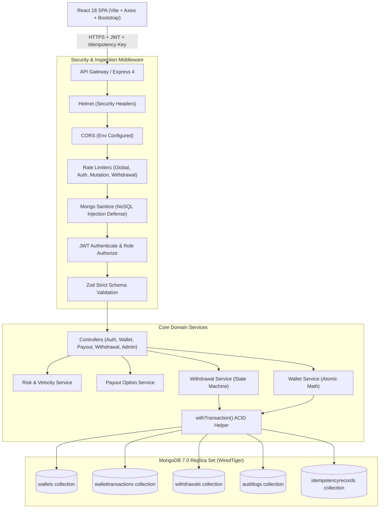
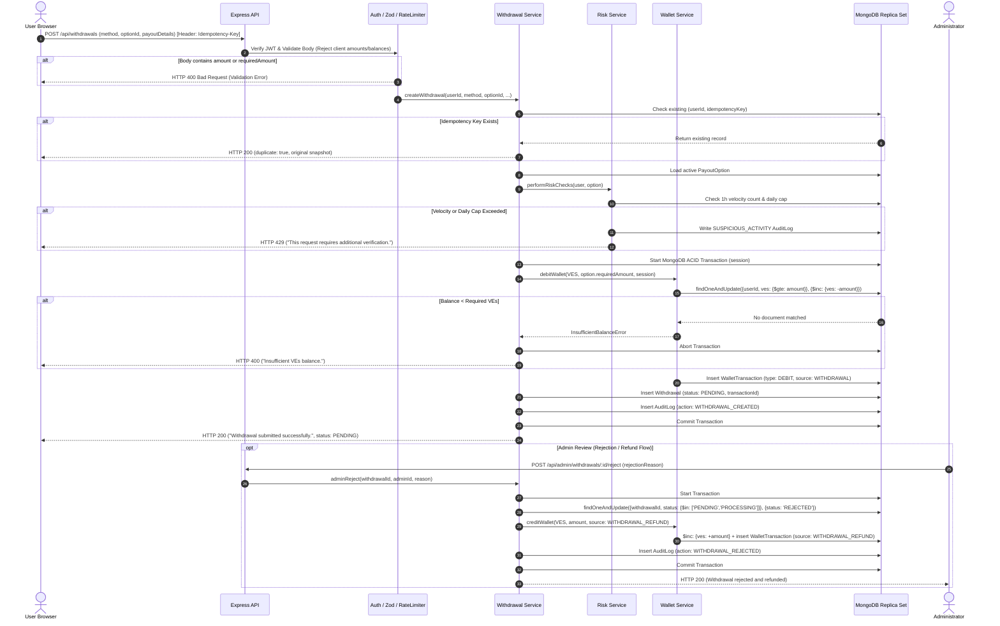

# VELoop Rewards Wallet & Payout System — System Architecture

## Architectural Principles
1. **Zero Client Trust**: The frontend is only a UI display. The backend owns 100% of the money and balance arithmetic.
2. **Double-Entry Ledger Invariant**: Every change to a wallet balance must be accompanied by an immutable transaction record storing `balanceBefore` and `balanceAfter`.
3. **Atomic Multi-Document Transactions**: Balance deductions and state mutations occur within a single MongoDB ACID transaction (`session`).
4. **Idempotency by Design**: Duplicate network requests (e.g. double-clicks or mobile retries) produce strictly one financial mutation.
5. **Compensating Refunds (Option A)**: Cancellations and rejections issue compensating credit entries (`WITHDRAWAL_REFUND`) preserving a full audit trail.

---

## Architectural Layers

---

## Withdrawal Flow Sequence Diagram

The diagram below details the exact transactional flow from user click to ledger persistence and administrative review.

---

## Failure Handling & Edge Case Matrix

| Failure Point | System Behavior | Data Consistency Result |
|---------------|-----------------|-------------------------|
| **Network drop during withdrawal creation** | Client retries with same `Idempotency-Key`. | Unique compound index `{userId: 1, idempotencyKey: 1}` returns original response. Zero duplicate debits. |
| **Simulated server crash after debit** | MongoDB multi-document transaction aborts automatically. | Balance change rolls back completely. Zero orphaned ledger rows. |
| **Insufficient user funds** | Conditional update `{ ves: { $gte: amount } }` matches 0 documents. | `InsufficientBalanceError` thrown immediately. No write persisted. |
| **Admin double-click on reject** | Conditional update matches `{ status: { $in: ['PENDING', 'PROCESSING'] } }`. Second call matches 0 docs. Unique partial index on `(referenceId, source)` also prevents duplicate refund. | Refund executed exactly once. User balance restored only once. |
| **Tampered client request** | Zod `.strict()` schema detects extraneous fields (`amount`, `balance`). | Rejection with HTTP 400 before financial services are invoked. |
| **Account suspended or flagged** | `riskService` intercept blocks request. | Account cannot initiate withdrawals; `SUSPICIOUS_ACTIVITY` audit log logged. |

