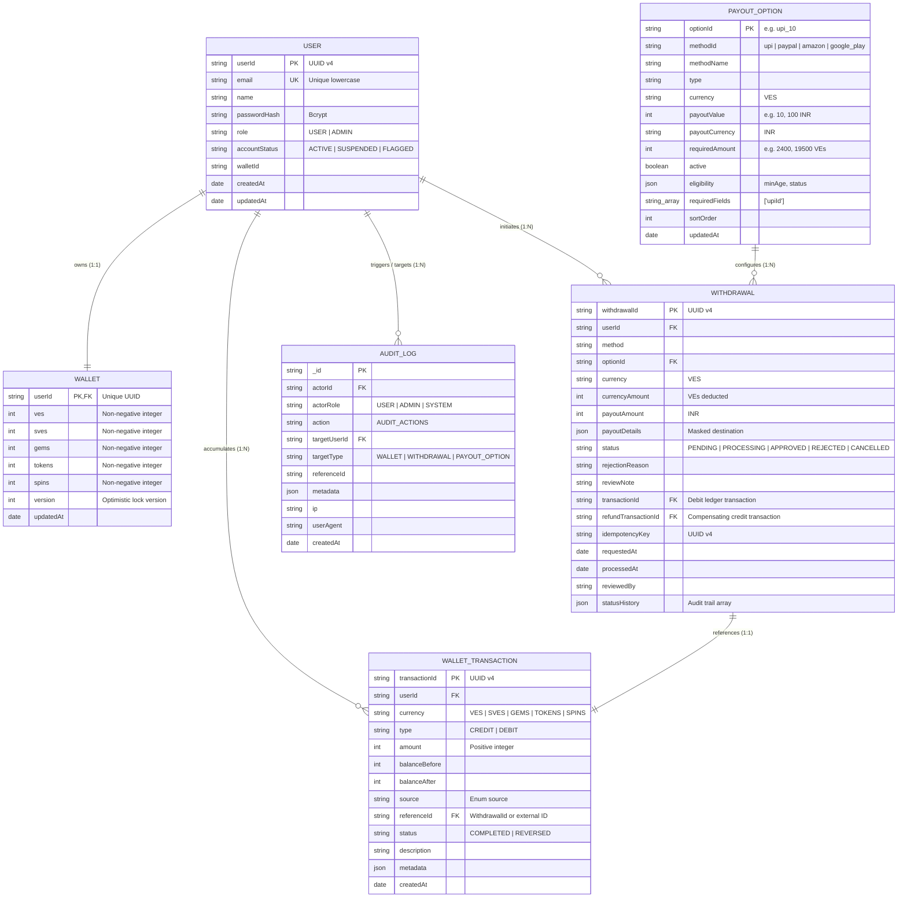

# VELoop Rewards Wallet & Payout System — Database Design & Data Architecture

## Overview
The VELoop Rewards database is designed around double-entry immutability, ACID transactions, strict multi-tenancy isolation, and race-condition prevention.

Multi-document transactions require a MongoDB Replica Set (`rs0`). All write operations touching user balances execute atomically with companion ledger entries.

---

## Entity Relationship Diagram

---

## Detailed Collections & Index Catalog

### 1. `users` Collection
Primary user authentication and profile registry.
- `userId` (String, UUID v4): Unique immutable identifier.
- `email` (String, Unique): Lowercase, trimmed email.
- `name` (String): Display name.
- `passwordHash` (String): Bcrypt salted hash (10 rounds).
- `role` (String): `USER` or `ADMIN`.
- `accountStatus` (String): `ACTIVE`, `SUSPENDED`, `FLAGGED`.

**Indexes**:
| Index Keys | Type | Purpose |
|------------|------|---------|
| `{ userId: 1 }` | Unique | Fast user lookup by ID |
| `{ email: 1 }` | Unique | Fast login and duplicate email prevention |

---

### 2. `wallets` Collection
Represents the current spendable balance state across all 5 authentic VELoop reward currencies.
- `userId` (String, Unique): 1:1 association with `User`.
- `ves` (Number, Integer >= 0): Spendable VEs (primary redeemable currency).
- `sves` (Number, Integer >= 0): Super VEs.
- `gems` (Number, Integer >= 0): In-app gems.
- `tokens` (Number, Integer >= 0): Game tokens.
- `spins` (Number, Integer >= 0): Daily wheel spins.
- `version` (Number): Incremented on every atomic `$inc` operation.

**Indexes**:
| Index Keys | Type | Purpose |
|------------|------|---------|
| `{ userId: 1 }` | Unique | Guaranteed single wallet per user |

---

### 3. `wallettransactions` Collection (Immutable Double-Entry Ledger)
Append-only log of every balance change. Once written, transactions are never updated or deleted.
- `transactionId` (String, UUID v4): Globally unique identifier.
- `userId` (String): Owner of the balance change.
- `currency` (String): Canonical uppercase currency (`VES`, etc.).
- `type` (String): `CREDIT` or `DEBIT`.
- `amount` (Number): Positive integer.
- `balanceBefore` (Number): Verified integer balance prior to execution.
- `balanceAfter` (Number): Verified integer balance after atomic modification.
- `source` (String): Allowed source enum.
- `referenceId` (String): Linked withdrawal ID, bonus ID, or batch ID.
- `status` (String): `COMPLETED` or `REVERSED`.

**Indexes**:
| Index Keys | Type | Options | Purpose |
|------------|------|---------|---------|
| `{ transactionId: 1 }` | Unique | | Idempotent transaction lookup |
| `{ userId: 1, createdAt: -1 }` | Compound | | Fast paginated user ledger history |
| `{ userId: 1, currency: 1, createdAt: -1 }` | Compound | | Filtered ledger queries by currency |
| `{ referenceId: 1 }` | Sparse | | Trace transactions from withdrawal references |
| `{ referenceId: 1, source: 1 }` | Compound Unique | `partialFilterExpression: { referenceId: { $type: "string" }, source: { $in: ["WITHDRAWAL", "WITHDRAWAL_REFUND"] } }` | **Database-level guarantee preventing duplicate debit or duplicate refund** |

---

### 4. `withdrawals` Collection
Tracks the life-cycle and state machine of cashout requests.
- `withdrawalId` (String, UUID v4): Unique withdrawal ID.
- `userId` (String): Requesting user.
- `method` (String): `upi`, `paypal`, `amazon_gift_card`, `google_play_gift_card`.
- `optionId` (String): Option tier referenced from `payoutoptions`.
- `currency` (String): Default `VES`.
- `currencyAmount` (Number): VEs debited from wallet.
- `payoutAmount` (Number): Real-world fiat payout value (e.g. 10, 100 INR).
- `payoutDetails` (Object): Masked recipient information (e.g. `sw***1@okaxis`).
- `status` (String): `PENDING` → `PROCESSING` → `APPROVED` / `REJECTED` / `CANCELLED`.
- `rejectionReason` (String): Mandatory reason on rejection.
- `transactionId` (String): Debit ledger reference.
- `refundTransactionId` (String): Compensating credit reference if rejected/cancelled.
- `idempotencyKey` (String): UUID passed by client header.
- `statusHistory` (Array): Detailed status transitions.

**Indexes**:
| Index Keys | Type | Options | Purpose |
|------------|------|---------|---------|
| `{ withdrawalId: 1 }` | Unique | | Fast lookup by withdrawal ID |
| `{ userId: 1, requestedAt: -1 }` | Compound | | User's recent withdrawal history |
| `{ status: 1 }` | Standard | | Admin review filtering by pending/processing |
| `{ userId: 1, idempotencyKey: 1 }` | Compound Unique | | **Hard guarantee preventing duplicate withdrawal creation on network retries or double-clicks** |

---

### 5. `payoutoptions` Collection
Catalog of active redemption tiers and currency exchange rates.
- `optionId` (String, Unique): e.g. `upi_10`, `upi_100`.
- `methodId` (String): Payout method category.
- `methodName` (String): Human-readable name.
- `payoutValue` (Number): Cash payout value.
- `requiredAmount` (Number): VEs required.
- `active` (Boolean): Controls availability.
- `eligibility` (Object): Account age days, required status.
- `requiredFields` (Array of Strings): Fields required in payload (e.g. `['upiId']`).

**Indexes**:
| Index Keys | Type | Purpose |
|------------|------|---------|
| `{ optionId: 1 }` | Unique | Denomination lookup |
| `{ methodId: 1, active: 1, sortOrder: 1 }` | Compound | Sorted client option display |

---

### 6. `auditlogs` Collection (Append-Only)
Security and compliance audit trail.
- `actorId`: User or admin ID.
- `actorRole`: `USER`, `ADMIN`, or `SYSTEM`.
- `action`: Audit action enum.
- `targetUserId`: Subject user.
- `referenceId`: Associated entity ID.
- `metadata`: Snapshot differences and audit context.
- `ip`: Client IP address.
- `userAgent`: Client user-agent string.

**Indexes**:
| Index Keys | Type | Purpose |
|------------|------|---------|
| `{ targetUserId: 1, createdAt: -1 }` | Compound | User audit timeline |
| `{ action: 1 }` | Standard | Filter by security action type |
| `{ referenceId: 1 }` | Standard | Trace actions on specific entities |

---

### 7. `idempotencyrecords` Collection
Generic snapshot cache for non-withdrawal mutations.
- `key` (String): Idempotency key.
- `userId` (String): Actor ID.
- `endpoint` (String): Target API endpoint.
- `requestHash` (String): SHA256 of request payload.
- `responseSnapshot` (Object): Cached response JSON.
- `expiresAt` (Date): TTL expiration.

**Indexes**:
| Index Keys | Type | Options | Purpose |
|------------|------|---------|---------|
| `{ userId: 1, key: 1, endpoint: 1 }` | Compound Unique | | Prevents duplicate mutation replay |
| `{ expiresAt: 1 }` | TTL | `expireAfterSeconds: 0` | Automatic document expiration |

